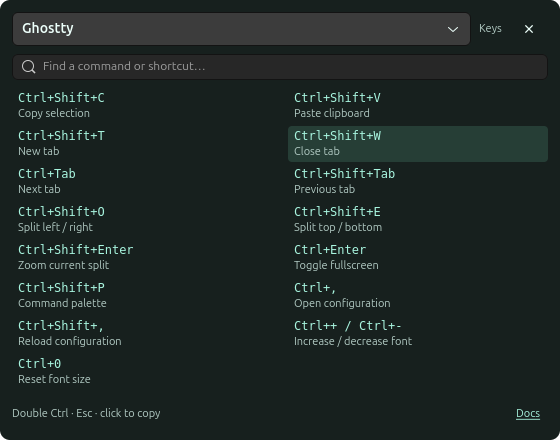

<div align="center">
  
  <h1>Clavis</h1>
  <p><strong>Your terminal shortcuts and commands — one double Ctrl away.</strong></p>
  <p>
    
    
    
    
  </p>
</div>

Clavis is a small desktop companion for remembering terminal shortcuts and everyday
commands without leaving your workflow. Tap and release **Ctrl twice**, choose a
tool, and find what you need in a compact two-column reference. Click an entry to
copy it; Clavis **never executes commands automatically**.

It works locally, without a Clavis account or hosted service. Reference content is
bundled with the executable; internet access is only needed when you open external
documentation, download dependencies, or fetch a release.

> [!NOTE]
> Clavis is under active development. Linux is the supported platform; current
> executable packages are unsigned development builds. Wayland keyboard detection
> requires explicit access to your selected keyboard devices.

<p align="center">
  
</p>

## What Clavis does

- Opens and hides its reference with two quick, released Ctrl taps.
- Displays Ghostty shortcuts and references for Git, SSH, curl, tmux, Vim, fzf,
  ripgrep, fd, jq and htop.
- Keeps commands and keyboard shortcuts clearly identified.
- Searches the selected tool's commands and descriptions.
- Copies full entries without executing them or modifying your terminal input.
- Remembers your last selected tool between launches.
- Provides a tray menu to show, hide, choose a tool, or quit.
- Reads simple explicit Ghostty keybindings or falls back to verified Linux defaults.
- Supports multiple configured keyboards on Wayland, with reconnection attempts.
- Offers official documentation links and tool-specific usage qualifications.

The extra tools are a curated developer-oriented selection, **not a measured global
usage ranking**. Research sources and content boundaries are documented in
[RESEARCH.md](RESEARCH.md).

## Requirements

### To use the Linux application

- A Linux desktop with GTK4 and a D-Bus session.
- X11, or Wayland with permission to read the keyboards you explicitly select.
- A StatusNotifier/AppIndicator host for the tray icon. Ubuntu GNOME usually has
  its AppIndicator extension enabled; other desktops may need one installed.
- For prebuilt executables, an architecture and distribution compatible with the
  build. Current release scripts produce native Linux packages, not universal
  static binaries.

The Debian package declares runtime dependencies derived from its actual executable.
The binary archive still requires system GTK4, X11/XTest and D-Bus libraries. Neither
format requires Rust, Python or Node.js to run. The referenced terminal tools do not
need to be installed just to browse their entries.

### To develop Clavis

- A recent [Rust toolchain](https://rustup.rs/) and Cargo.
- Git, a C toolchain, pkg-config and native development libraries.
- `dpkg-dev` to build Debian packages.
- `librsvg2-bin` and `ffmpeg` only when regenerating the icon.

On Ubuntu/Debian:

```bash
sudo apt install cargo rustc build-essential pkg-config \
  libgtk-4-dev libx11-dev libxi-dev libxtst-dev libdbus-1-dev dpkg-dev
```

## Using Clavis

### Open the panel

```bash
clavis --show
```

To start silently and wait for double Ctrl:

```bash
clavis
```

Only one instance runs per desktop session. The application menu entry is **Clavis**.
Press Esc or close the panel to hide it; the listener stays running. Quit through the
tray menu, or run `pkill -x clavis`.

### Use double Ctrl

Press and release Ctrl, then press and release it again within about **380 ms**.
Either Ctrl key works. Clavis triggers on the second release, so ordinary Ctrl+C,
Ctrl+V and other chords cancel detection rather than opening the panel. Long holds
and repeated keydown events do not trigger it.

Ctrl by itself does not insert letters, and Clavis does not delay your typing.
Events still reach the focused application; that application may have its own
behavior for double Ctrl. Detection and modifier state are tracked per keyboard.
Wayland also controls window focus and placement; always-on-top is not guaranteed.

```bash
CLAVIS_TAP_DELAY=0.5 clavis
```

### Enable keyboard access on Wayland

List keyboard candidates and configure the devices you want to use:

```bash
clavis --list-keyboards
/usr/lib/clavis/enable-keyboard.sh --all
```

The second command is the setup script installed by the Debian package. For a source
or archive install, use `./enable-keyboard.sh --all` from its directory. You can also
select individual devices:

```bash
./enable-keyboard.sh /dev/input/event3 /dev/input/event15
```

The script lists the chosen devices and asks for confirmation before granting your
user read access. Restart Clavis after changing the selection. Check access with:

```bash
clavis --check-input
clavis --diagnose
```

`--check-input` reports every configured device. `--diagnose` prints connection
notices and double-Ctrl detections, not ordinary keystrokes.

> [!IMPORTANT]
> Keyboard ACLs can reset after a reboot or reconnect. Rerun setup when access is
> lost. Granting this access also lets other processes running as your user read
> those keyboards, including password keystrokes. Clavis does not save or transmit
> keys, run its interface as root, or add input-group membership.

Configured keyboards are reopened after disconnects, with name checks before reused
input paths are opened. Identically named keyboards can be ambiguous; stable device
paths are preferable. Newly added keyboards must be configured explicitly. Some
composite receiver interfaces are named Mouse while exposing keyboard capabilities.

If you prefer not to grant input access, bind `clavis --show` to a compositor shortcut.

### Browse and copy references

Choose a tool, search its reference, and click an entry to copy the complete text.
Replace placeholders before pasting commands into a shell. Keyboard descriptions
are not shell commands; some commands can modify repositories or remote services.
Hover over **Docs** for tool-specific qualifications, then open its upstream manual.

## Development

Clone the repository and work from its root:

```bash
git clone https://github.com/megara-arevaco/clavis.git
cd clavis
cargo test --locked
cargo build --release --locked
```

Run the application:

```bash
cargo run -- --show
```

The unit suite covers double-Ctrl timing, releases, held keys, chord cancellation,
keyboard capability parsing, multi-device configuration, duplicate event protection,
reference search, catalog structure, grid positions and tray pixel layout. The tests
do not require capturing your keyboard or displaying a GTK window.

For native visual verification on an interactive desktop, stop other instances first:

```bash
./target/release/clavis --tool Ghostty --capture /tmp/clavis-ghostty.png
```

This renders only the app's GTK panel to a PNG and exits; it does not capture your
desktop or other applications. Hardware input, tray hosting and compositor focus
still need verification in a real desktop session.

## Building Linux executables

Build a tested release binary, Debian installer and executable archive:

```bash
./build-dist.sh
```

The current version produces:

```text
dist/clavis_0.4.3_amd64.deb
dist/clavis-0.4.3-linux-amd64.tar.gz
dist/SHA256SUMS
```

Install the Debian package on a compatible Ubuntu/Debian system:

```bash
sudo apt install ./dist/clavis_0.4.3_amd64.deb
```

Alternatively extract the archive and run its installer:

```bash
tar -xzf dist/clavis-0.4.3-linux-amd64.tar.gz
cd clavis-0.4.3-linux-amd64
./install.sh
# Or: ./install.sh --user
```

The archive includes the compiled executable, desktop icon, installer, uninstaller
and keyboard setup script. Installing it does not invoke Cargo. Building from source
with `./install.sh` does require Cargo and the native build dependencies.

Installers add an application-menu entry and silent login autostart, but **never grant
keyboard permissions automatically**. Personal settings and ACLs are retained on
uninstall. Remove a Debian installation with `sudo apt purge clavis`, or use the
archive's `uninstall.sh` (`--user` for a user installation). Stop running instances
separately.

## Project structure

```text
clavis/
├── src/                   Rust application and desktop integration
│   ├── main.rs             Lifecycle, X11 input and event dispatch
│   ├── input.rs            Wayland/evdev, keyboard selection and double Ctrl
│   ├── ui.rs               GTK reference grid, search, copy and captures
│   ├── tray.rs             StatusNotifier icon and menu
│   └── catalog.rs          Reference content and remembered selection
├── packaging/              Icon source/exports and desktop entry
├── scripts/                Icon regeneration
├── tooling/github/         Optional CI and release workflow templates
├── docs/screenshots/       Application-only README screenshot
├── catalog.json            Extra terminal-tool references
├── shortcuts.json          Bundled Ghostty Linux reference
├── install.sh              Source and executable-archive installer
├── enable-keyboard.sh      Explicit keyboard permission setup
└── build-dist.sh            Release binary, .deb, archive and checksums
```

## Publishing a release

Update the version in `Cargo.toml`, refresh `Cargo.lock`, update the README artifact
names, run the validation commands, and commit the change. Create a matching tag:

```bash
git tag -a v0.4.3 -m "Clavis 0.4.3"
git push origin v0.4.3
```

Optional workflow templates are included under `tooling/github/`. They are **not
active GitHub Actions workflows** until copied into `.github/workflows/`, committed
and pushed. Uploading workflow files through a GitHub CLI OAuth token requires the
additional `workflow` scope:

```bash
gh auth refresh --scopes workflow
mkdir -p .github/workflows
cp tooling/github/*.yml .github/workflows/
git add .github/workflows
git commit -m "Enable CI and release workflows"
git push
```

When enabled, the release workflow verifies the tag against the package version,
builds on an Ubuntu runner, runs the unit suite, generates the Debian installer and
binary archive, and publishes them with `SHA256SUMS` and generated release notes.
The CI template builds and uploads artifacts without publishing a release. Neither
workflow grants keyboard access or verifies physical keyboards.

Without these workflows enabled, build and publish a release manually:

```bash
./build-dist.sh
gh release create v0.4.3 dist/clavis_0.4.3_amd64.deb \
  dist/clavis-0.4.3-linux-amd64.tar.gz dist/SHA256SUMS \
  --verify-tag --generate-notes --title "Clavis 0.4.3"
```

Builds are unsigned. The `dist/` directory is intentionally ignored: executables
belong in GitHub Releases, not in source control.

## Data locations and privacy

Personal settings live under `$XDG_CONFIG_HOME/clavis` (default `~/.config/clavis`):

- `keyboards`: selected input paths and expected device names.
- `last-tool`: your last selected reference.

Ghostty's explicit config bindings are read from `$XDG_CONFIG_HOME/ghostty/config`.
This is a lightweight reference parser, not a full effective-keymap resolver: includes,
resets and conditional bindings are not resolved. The other references are bundled
in `catalog.json`.

Clavis does not inspect shell history, terminal content or foreground window titles.
It has no telemetry and does not save keystrokes. Device ACLs are managed by the
operating system; to revoke one:

```bash
sudo setfacl -x "u:$(id -u)" /dev/input/eventN
```

`CLAVIS_KEYBOARD=/dev/input/eventN` temporarily selects one device. The old
`GHOSTTY_EE_KEYBOARD`, `GHOSTTY_EE_DELAY` variables and single-keyboard configuration
remain readable for migration; they do not restore the old ee trigger.

The Debian autostart entry is `/etc/xdg/autostart/clavis.desktop`. Override it with a
same-named user entry containing `Hidden=true` to disable login startup. Archive
installations use `~/.config/autostart/clavis.desktop`.

## Regenerating the icon

The source artwork is [`packaging/clavis.svg`](packaging/clavis.svg): a mint C around
a terminal prompt. Generate the application PNG and the tray's embedded ARGB pixmap
from that single source:

```bash
sudo apt install librsvg2-bin ffmpeg
./scripts/render-icon.sh
cargo build --release --locked
```

Generated icon files carry provenance sidecars. Their renderers are development tools,
not application runtime dependencies.

## License

Clavis is available under the [MIT License](LICENSE). Third-party dependencies
retain their own licenses; their versions are pinned in `Cargo.lock`. GTK4, D-Bus
and X11 runtime libraries are supplied by the operating system.
